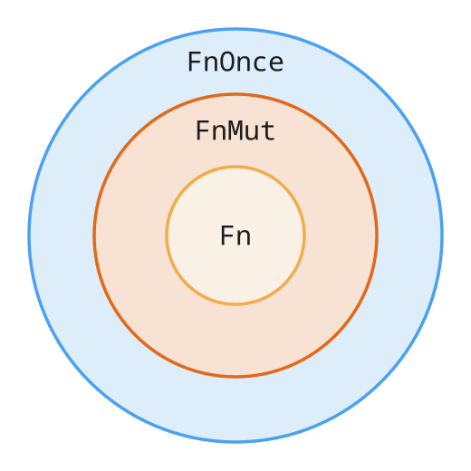

## Intro to Rust Lang

# Closures and Iterators


---


# Today: Closures and Iterators

- Review
- Closures
- Iterators


---


# Why Closures?

Here's some code from the `anyhow` crate example in last lecture:

```rust
let content = std::fs::read(path)
    .with_context(|| format!("Failed to read instrs from {}", path))?;
```

* `|| format!(...)` is a _closure_, a small function written inline
* `with_context` only calls it if reading the file fails
  * So we only build the error message when we actually need it
* By the end of today, every piece of this line will make sense
* But first, a review, since it's been two weeks!


---


# Review: When Does a Borrow End?

Does this compile?

```rust
let mut s = String::from("hi");
let r = &s;          // ─┐ `r` borrows `s`
println!("{r}");     // ─┘ Last use of `r`
s.push('!');         // ── `push` borrows `s` mutably
```

* Yes! A borrow ends at its **last use**, not at the end of the scope
* The two borrows don't overlap, so there's no conflict
* With `println!` moved below `push`, they would overlap and not compile
  * Closures follow this same rule today


---


# Review: Move vs. `Copy`

```rust
let s1 = String::from("hi");
let s2 = s1;          // `s1` is moved into `s2`
// println!("{s1}");  // Error, `s1` was moved

let n1 = 5;
let n2 = n1;          // `i32` is `Copy`, so `n1` is copied
println!("{n1}");     // OK
```

* Assigning or passing a value moves it, unless its type is `Copy`
* `Copy` types: integers, `bool`, `char`, and shared references `&T`
* Not `Copy`: `String`, `Vec`, and anything that owns heap data


---


# Review: `self`, `&self`, and `&mut self`

```rust
impl Counter {
    fn get(&self) -> u32 { self.n }       // Borrows the counter
    fn bump(&mut self) { self.n += 1; }   // Mutably borrows it
    fn finish(self) -> u32 { self.n }     // Takes ownership of it
}

let mut c = Counter { n: 0 };  // `mut` needed to call `bump`
c.bump();
let n = c.finish();            // `c` can't be used after this
```

* `mut` on a binding is what allows `&mut` borrows of it
* Calling a `self` method moves the value into the method


---


# Review: References and `*`

```rust
let x = 5;
let r = &x;            // `r` is a `&i32` pointing at `x`
assert_eq!(*r, 5);     // `*` follows the reference to the value
// assert!(r == 5);    // Error, can't compare `&i32` with `i32`

let mut y = 1;
let m = &mut y;
*m += 1;               // Write through a `&mut`
```

* `&` makes a reference, and `*` gets back the value it points to
* A `&i32` and an `i32` are different types
  * Iterators hand us references a lot today, so watch for this


---


# Review: Trait Bounds

Three ways to say "any type that implements `Display`"

```rust
fn show<T: Display>(item: T) -> String { ... }

fn show<T>(item: T) -> String where T: Display { ... }

fn show(item: impl Display) -> String { ... }
```

* `where` is handy when bounds get long
* `impl Trait` also works for return types, as in `fn make() -> impl Display`
  * The caller only knows the returned type implements `Display`


---


# Review: Counting Types

Write `|T|` for how many values a type `T` has

| Type | Number of values |
| --- | --- |
| `()` | 1 |
| `struct Pair(bool, bool)` | 2 × 2 = 4 |
| `Option<bool>` | 1 + 2 = 3 |
| `!` | 0 |

* Structs multiply their fields, enums add their variants
* `!` (never) has no values, since `loop {}` and `panic!` never produce one


---
layout: section
---

# **Closures**


---


# What Is A Closure?

Closures are anonymous functions that can capture values from the scope in which they're defined.

* Known as lambdas in "lesser languages" 😉
* You can save closures in variables or pass them as arguments to other functions


---


# Closure Syntax

```rust
let annotated_closure = |num: i32| -> i32 {
    num
};
```

* This should feel very similar to functions we've seen...
* Like normal variables, Rust can derive closure type annotations from context!


---


# Closures Simplified

```rust
fn  add_one_v1   (x: i32) -> i32 { x + 1 }
let add_one_v2 = |x: i32| -> i32 { x + 1 };
let add_one_v3 = |x|             { x + 1 };
let add_one_v4 = |x|               x + 1  ;

let _ = add_one_v3(3);
let _ = add_one_v4(4);
```

* `v1` is the equivalent function
* We can remove the type annotations in `v3`
  * Including the return type, since Rust infers both
  * This is similar to eliding the type in `let v = Vec::new()`
* For `v4`, we can remove the `{}` since the body is a single expression

<!--
Bad formatting on purpose to show similarities
-->


---
class: image-right image-width-25
---

# How about this?


```rust
let example_closure = |x| x;

let s = example_closure(String::from("hello"));
let n = example_closure(5);
```

* How would we describe the type of `example_closure`?


---


# Closure Types

```rust
let example_closure = |x| x;
let s = example_closure(String::from("hello"));
let n = example_closure(5);
```

```ansi
error[E0308]: mismatched types
 --> src/main.rs:4:29
  |
4 |     let n = example_closure(5);
  |             --------------- ^ expected `String`, found integer
  |             |
  |             arguments to this function are incorrect
<-- snip -->
```


---


# Closure Types

```rust
let example_closure = |x| x;

let s = example_closure(String::from("hello"));
let n = example_closure(5);
```

* Closures can't be generic, so each one has a single concrete signature
* Here Rust infers it from the first call, `String -> String`
  * So `example_closure(5)` will not type check
* For any type, use a generic function, `fn identity<T>(x: T) -> T`
* Unlike SML or OCaml, where `fn x => x` works on every type


---


# Capturing References

Closures can capture values from their environment in three ways:
* Borrowing immutably
* Borrowing mutably
* Taking ownership (_**moving**_ the value into the closure)

<v-click>

Rust picks the least powerful one the body needs, in that order

</v-click>

* It only moves a value if the body moves it, or if we ask with `move`
* It captures individual struct fields, like `p.score`, not all of `p`


---


# Immutable Borrowing in Closures

```rust
let list = vec![1, 2, 3];
println!("Before defining closure: {:?}", list);

let only_borrows = || { println!("From closure: {:?}", list); };

println!("Before calling closure: {:?}", list);
only_borrows(); // Prints "From closure: [1, 2, 3]"
println!("After calling closure: {:?}", list);
```

```
Before defining closure: [1, 2, 3]
Before calling closure: [1, 2, 3]
From closure: [1, 2, 3]
After calling closure: [1, 2, 3]
```


---


# Immutable Borrowing in Closures

```rust
let list = vec![1, 2, 3];
println!("Before defining closure: {:?}", list);

let only_borrows = || { println!("From closure: {:?}", list); };

println!("Before calling closure: {:?}", list);
only_borrows(); // Prints "From closure: [1, 2, 3]"
println!("After calling closure: {:?}", list);
```

* Note how once a closure is defined, it's invoked in the same manner as a function
* Because we can have many immutable borrows, Rust allows us to to print, even with the closure holding a reference

<!--
Make sure to state that `println!` implicitly takes references to anything passed in,
that's why it doesn't move the list
-->


---
class: image-right image-width-25
---

# Mutable Borrowing in Closures


What happens if we mutate captured variables from inside the closure?

```rust
let mut list = vec![1, 2, 3];
println!("Before defining closure: {:?}", list);

let borrows_mutably = || { list.push(7); };

borrows_mutably();
println!("After calling closure: {:?}", list);
```

* This seems like it should work...


---


# Mutable Borrowing in Closures

```ansi
error[E0596]: cannot borrow `borrows_mutably` as mutable,
 as it is not declared as mutable
 --> src/main.rs:7:5
  |
5 |     let borrows_mutably = || { list.push(7); };
  |                                ---- calling `borrows_mutably` requires mutable
                                     binding due to mutable borrow of `list`
6 |
7 |     borrows_mutably();
  |     ^^^^^^^^^^^^^^^ cannot borrow as mutable
<-- snip -->
```

* A closure mutating its captured state is _equivalent_ to mutating _itself_
  * Calling `borrows_mutably` mutates the closure's internal state
    * We'll see why at the end of this section


---


# Mutable Borrowing in Closures

```ansi
help: consider changing this to be mutable
  |
5 |     let mut borrows_mutably = || { list.push(7); };
  |         +++
<-- snip -->
```

* As always, the compiler tells us how to fix our mistake!


---


# Mutable Borrowing in Closures

```rust
let mut list = vec![1, 2, 3];
println!("Before defining closure: {:?}", list);

let mut borrows_mutably = || { list.push(7); };

borrows_mutably();
println!("After calling closure: {:?}", list);
```

```
Before defining closure: [1, 2, 3]
After calling closure: [1, 2, 3, 7]
```


---
class: image-right image-width-25
---

# Closure Borrowing Rules


What if we print `list` between defining and calling the closure?

```rust
let mut list = vec![1, 2, 3];

let mut borrows_mutably = || { list.push(7); };

println!("Before calling closure: {:?}", list);
borrows_mutably();
println!("After calling closure: {:?}", list);
```


---


# Closure Borrowing Rules

```ansi
error[E0502]: cannot borrow `list` as immutable
 because it is also borrowed as mutable
 --> src/main.rs:6:46
  |
4 |     let mut borrows_mutably = || { list.push(7); };
  |                               --   ---- first borrow occurs due to
  |                               |         use of `list` in closure
  |                               |
  |                               mutable borrow occurs here
5 |
6 |     println!("Before calling closure: {:?}", list);
  |                                              ^^^^ immutable borrow occurs here
7 |     borrows_mutably();
  |     --------------- mutable borrow later used here
```


---


# Closure Borrowing Rules

```rust
let mut list = vec![1, 2, 3];

let mut borrows_mutably = || { list.push(7); }; // ─┐ Closure borrows `list`
// println!("{:?}", list);                      //  │ Error, overlaps the borrow
borrows_mutably();                              // ─┘ Last use of the closure
println!("After calling closure: {:?}", list); // ── OK, no overlap
```

* The closure borrows `list` when it is **defined**, not when it is called
* That borrow lasts until the closure's last use, just like a reference
* A `println!` inside the bracket overlaps the borrow, so it fails


---
class: image-right image-width-25
---

# Giving Closures Ownership


```rust
let mystery = {
    let x = rand::random::<u32>();
    |y: u32| -> u32 { x + y }
};

println!("Mystery value is {}", mystery(5));
```

<!--
Make sure people understand that we're trying to bind a closure to `mystery`
-->


---


# Giving Closures Ownership

```ansi
error[E0373]: closure may outlive the current block, but it borrows `x`,
 which is owned by the current block
 --> src/main.rs:4:9
  |
4 |         |y: u32| -> u32 { x + y }
  |         ^^^^^^^^^^^^^^^   - `x` is borrowed here
  |         |
  |         may outlive borrowed value `x`
  |
<-- snip -->
help: to force the closure to take ownership of `x`
(and any other referenced variables), use the `move` keyword
  |
4 |         move |y: u32| -> u32 { x + y }
  |         ++++
<-- snip -->
```

---


# Giving Closures Ownership

```rust
let mystery = {
    let x = rand::random::<u32>();
    move |y: u32| -> u32 { x + y }
//  ^^^^ Add the `move` keyword!
};

println!("Mystery value is {}", mystery(5));
```

* We can `move` values into closures instead of capturing references (borrowing)
  * `move` applies to every captured variable, not just some of them
* The same idea lets a function return a closure
  * `fn make_adder(n: i32) -> impl Fn(i32) -> i32 { move |x| x + n }`


---


# Moving Only Some Captures

What if we want to move `greeting` but only borrow `name`?

```rust
let name = String::from("Ferris");
let greeting = String::from("Hello");

let name_ref = &name;  // Borrow `name` outside the closure
let greet = move || println!("{greeting}, {name_ref}!");

greet();
println!("{name}");        // OK, the closure only owns a reference to `name`
// println!("{greeting}"); // Error, `greeting` was moved into the closure
```

* `move` moves `name_ref` into the closure, and `name_ref` is just a reference
* So `greeting` is owned by the closure, while `name` is only borrowed

---


# Threads Sneak Peek

Let's briefly explore spawning a new thread with a closure.

```rust
fn main() {
    let list = vec![1, 2, 3];
    println!("Before defining closure: {:?}", list);

    std::thread::spawn(move || println!("From thread: {:?}", list))
        .join()
        .unwrap();
}
```

* `move` is often needed when handing a closure to another thread


---


# Why `move`?

What if we borrow `list` instead?

```rust
fn main() {
    let list = vec![1, 2, 3];

    std::thread::spawn(|| println!("From thread: {:?}", list))
        .join()
        .unwrap();
}
```

* The thread's `println!` only needs a reference to `list`...


---


# Why `move`?

```ansi
error[E0373]: closure may outlive the current function, but it borrows `list`,
 which is owned by the current function
 --> src/main.rs:4:24
  |
4 |     std::thread::spawn(|| println!("From thread: {:?}", list))
  |                        ^^                               ---- `list` is
  |                        |                                     borrowed here
  |                        |
  |                        may outlive borrowed value `list`
  |
note: function requires argument type to outlive `'static`
<-- snip -->
help: to force the closure to take ownership of `list`
(and any other referenced variables), use the `move` keyword
```


---


# Why `move`?

* `spawn` doesn't know we `join` right away
  * A spawned thread could keep running after `main`'s locals are dropped
* So `spawn` only accepts closures that don't borrow local variables
  * This is the `'static` requirement in the error, covered next week in Lifetimes
* `move` gives the closure ownership of `list`, so nothing is borrowed
* Without this rule, the thread could read `list` after it was freed ☠️
  * A use-after-free that is easy to write in other languages!


---


# Borrowing in Threads: `thread::scope`

```rust
let mut list = vec![1, 2, 3];

std::thread::scope(|s| {
    s.spawn(|| println!("From thread: {:?}", list));
    s.spawn(|| println!("Also from thread: {:?}", list));
}); // All threads spawned in the scope are joined here

list.push(4);
```

* `scope` guarantees every thread finishes before it returns
* So these threads _can_ borrow `list`, and no `move` is needed
* More on threads in the Parallelism and Concurrency lectures


---


# Closures Under the Hood

```rust
let greet = move |greeting: &str| println!("{greeting}, {name}!");
```

Rust turns this closure into roughly

```rust
struct Greet { name: String } // One field per captured variable

impl Greet {
    fn call(&self, greeting: &str) { println!("{greeting}, {}!", self.name); }
}
```

* A closure is a value of an anonymous struct, with its captures as fields


---


# Counting Functions

- Function types have a count too: `|fn(A) -> B| = |B|^|A|`
    - Each of the `|A|` inputs can map to any of the `|B|` outputs
    - Matches math, where the set of functions `A -> B` is written `B^A`
- e.g. `fn(bool) -> bool` has `2² = 4` (ignoring side effects)

```rust
fn identity(x: bool) -> bool     { x }
fn not(x: bool) -> bool          { !x }
fn always_true(_: bool) -> bool  { true }
fn always_false(_: bool) -> bool { false }
```


---


# Counting Functions

`|fn(!) -> T| = |T|^0 = 1`, meaning there's exactly one way to turn a `!` into a `T`

```rust
fn absurd<T>(x: !) -> T {
    match x {} // `!` has no values, so no arms are needed
}
```

* Intuition: when `!` coerces into a type, it's as if the compiler calls `absurd` for you
    * `absurd` can never actually run, since there's no `!` value to call it with


---


# Function Pointers

Functions are values too, and their type is a _function pointer_, written `fn`.

```rust
fn add_one(x: i32) -> i32 {
    x + 1
}

fn do_twice(f: fn(i32) -> i32, arg: i32) -> i32 {
    f(arg) + f(arg)
}

let answer = do_twice(add_one, 5); // 12
```

* `fn(i32) -> i32` is a real type, a pointer to any function with that signature


---


# Function Items and Function Pointers

```rust
let f = add_one;                  // `add_one`'s own unique type, 0 bytes
let g: fn(i32) -> i32 = add_one;  // A function pointer, 8 bytes

do_twice(|x| x * 2, 5);           // OK, the closure captures nothing

let n = 3;
// do_twice(|x| x * n, 5);        // Error, the closure captures `n`
```

* Every function has its own type, which converts to a `fn` pointer when needed
* Closures that capture nothing also convert to `fn` pointers
* Closures that capture something can't, since a pointer to code has nowhere to store `n`
  * The `Fn` traits in the next section let us accept those too


---
layout: section
---

# **The `Fn` traits**

---


# Handling Captured Values

* A closure body can do any of the following to a value:
  * Move a captured value out of the closure
  * Mutate a captured value
  * Neither of the above
* It could also have captured nothing to begin with!
* The properties a closure has determines the function _trait_ it implements


---


# The `Fn` traits

What do you mean, function _**trait**_???
* Used to describe how a closure captures and handles its environment
  * And by functions & traits to specify what types of closures they can use
* Rust has three special function traits for this reason
  * `FnOnce`, `FnMut`, and `Fn`
  * Rust auto-implements one, two, or three of these for each closure
    * Depending on how it deals with the environment

---

# `FnOnce`

The `FnOnce` trait indicates closures that can be called once
- All closures and functions implement this, since all closures can be called _at least_ once
- Closures that are exclusively `FnOnce` can _only_ be called once
  * E.g., A closure that moves captured values out of its body

---

# `FnMut`

The `FnMut` trait indicates a closure that _can_ mutate the captured values because it does not move them outside the body
- Can be called more than once

---

# `Fn`
The `Fn` trait indicates closures that only read their captured values

A closure is `Fn` only if **both** of these are true
  * It doesn't move captured values out
  * It doesn't mutate captured values

Closures that capture nothing at all are always `Fn`

---


# Three Ways to Call

| Body | Method | Trait |
|---|---|---|
| Moves a captured value out | `call_once(self)` | `FnOnce` |
| Mutates a captured value | `call_mut(&mut self)` | `FnMut` |
| Only reads captured values | `call(&self)` | `Fn` |

* `self` uses up the closure, so it can only be called once
* `&mut self` is why `borrows_mutably` needed `let mut`


---
class: image-right image-width-45
---

# The `Fn` traits: Visualized



Each circle is the set of closures that implement that trait

* Every `FnMut` closure is also `FnOnce`
* Every `Fn` closure is also `FnMut` _and_ `FnOnce`
* So `Fn` closures are a _subset_ of `FnMut` closures, which are a _subset_ of `FnOnce` closures


---


# Why the Circles Nest

In the standard library, the `Fn` traits are ordinary supertraits

```rust
trait FnOnce { ... }
trait FnMut: FnOnce { ... }
trait Fn: FnMut { ... }
```

* Same idea as `trait Student: Person` from lecture 5
* If you can call a closure through `&self`, you can also call it through
  * `&mut self`, since a `&mut` can do anything a `&` can
  * `self`, by calling it once and then dropping it

---


# `FnOnce`

A closure that moves captured values **out** of its body will _only_ implement `FnOnce`

```rust
let my_str = String::from("x");

// Returns `my_str`, moving it out of the closure
let consume_and_return = || my_str;

let s = consume_and_return();
// consume_and_return(); // Error, `my_str` was already moved out
```

* The first call moves `my_str` out to the caller
  * Rust never implicitly clones it, so there's nothing left for a second call
* Useful for actions that must happen exactly once, like closing a file


---


# `move` vs. the `Fn` traits

```rust
let name = String::from("Ferris");
let give_away = || name;            // No `move`, but only `FnOnce`

let count = 5;
let add = move |x: i32| x + count;  // `move`, but still `Fn`
```

* `move` decides how values are **captured** (by value), when the closure is _created_
* The `Fn` traits depend on what the body **does** with them when it is _called_
* These are independent
  * `give_away` moves `name` out, so it's `FnOnce` even without `move`
  * `add` owns `count` but only reads it, so it's `Fn`


---


# `unwrap_or_else`

All closures implement `FnOnce`, since all closures can be called once.

* This does not mean they can _only_ be called once!
* One example is the `unwrap_or_else` method on `Result`


---


# `unwrap_or_else`

`unwrap_or_else` unwraps a `Result<T, E>`, computing a fallback from the error if needed.

```rust
let count = |s: &str| s.len();

assert_eq!(Ok(2).unwrap_or_else(count), 2);
assert_eq!(Err("foobar").unwrap_or_else(count), 6);
```

* If successful, it unwraps the value from `Ok(T)` into `T`
* Otherwise, it takes `E` as input to the closure


---


# `unwrap_or_else`

Let's look at the definition of the `unwrap_or_else` method on `Result<T, E>`.

```rust
impl<T, E> Result<T, E> {
    pub fn unwrap_or_else<F>(self, f: F) -> T
    where
        F: FnOnce(E) -> T
    {
        match self {
            Ok(t) => t,
            Err(e) => f(e),
        }
    }
}
```

<!--
Simplified from the standard library:
https://doc.rust-lang.org/src/core/result.rs.html#1460-1465
-->


---


# `unwrap_or_else`

First let's observe the function definition.

```rust
pub fn unwrap_or_else<F>(self, f: F) -> T
where
    F: FnOnce(E) -> T
// <-- snip -->
```

* This method is generic over `F`
* `F` is the type of the closure we provide when calling `unwrap_or_else`
  * `F` must be callable once, take the error `E`, and return the success type `T`
* `FnOnce` is the _least_ restrictive bound here
  * Every closure implements `FnOnce`, so callers can pass any closure with this signature


---


# `unwrap_or_else`

Now let's observe the function body.

```rust
{
    match self {
        Ok(t) => t,
        Err(e) => f(e),
    }
}
```

* If the `Result` is `Ok`, extract the inner value
* Otherwise, call `f` once on the error and return its result
* Note that `f` is not _required_ to only be `FnOnce` here
  * It is valid for `f` to be `FnMut` or `Fn`


---


# `FnMut`

`FnMut` applies to closures that _might_ mutate the captured values.

```rust
let mut x: usize = 1;
let mut add_two_to_x = || x += 2;
add_two_to_x();
```

* Use cases: Stateful operations on some shared resource
  * Imagine `x` were a score on a scoreboard
* Note that this will not compile without the second `mut`
  * `mut` signals that we are mutating our closure's environment

<!--
Key idea: how variables within scope at invocation change between calls

Use case: Stateful operation to some shared resource
  The captured variable is some shared resource, like a score on a scoreboard,
  a message queue, etc.
-->


---


# `FnMut`

Another simple example:

```rust
let mut base = String::from("");
let mut build_string = |addition| base.push_str(addition);

build_string("Ferris is ");
build_string("happy!");

println!("{}", base);
```

```
Ferris is happy!
```


---


# `FnMut`

We can pass an `FnMut` closure as an argument to a function.

```rust
fn do_twice<F>(mut func: F)
where
    F: FnMut(),
{
    func();
    func();
}
```

* Would `do_twice` accept a closure that's exclusively `FnOnce`?
  * No, because we call our closure twice
* How about an `Fn` closure?
  * Yes!


---


# `Fn`

Every `Fn` closure is also `FnMut` and `FnOnce`.

* `Fn` applies to closures that don't move captured values out of their body **and** don't mutate them
  * This includes closures that capture nothing at all
* Can be called more than once without changing its captured values
* `Fn` does not mean "pure", since an `Fn` closure can still print or write files
* Use cases include logging, pretty printing, and predicates
  * `std` usually asks for `FnMut` predicates since that accepts more closures, but the ones we pass are usually `Fn`


---


# `Fn`

`Fn` applies to closures that don't capture anything from their environment:

```rust
let double = |x| x * 2; // captures nothing

assert!(double(2) == 4);
```

---

# `Fn`

`Fn` also applies to closures that don't mutate captured variables:

```rust
let mascot = String::from("Ferris");
let is_mascot = |guess| guess == mascot; // `mascot` immutably borrowed

assert!(is_mascot("Ferris"));    // true
assert!(!is_mascot("Ferrari"));  // false
```


---


# `Fn`

Closures can be passed as arguments to other functions.

```rust
fn reduce<F, T>(reducer: F, data: Vec<T>) -> Option<T>
where
    F: Fn(T, T) -> T,
{ /* <-- snip --> */ }

let sum = reduce(|a, b| a + b, vec![1, 2, 3]); // Some(6)
```

* `Fn(T, T) -> T` gives the closure's argument and return types
* Each closure has a unique type, so we take a generic `F`
  * To store different closures together, use `Box<dyn Fn(T, T) -> T>`
* `std` has this as `Iterator::reduce`, with an `FnMut` bound


---


# Recap: Closure Traits

* `Fn`, `FnMut`, `FnOnce` describe different groups of closures
  * You don't `impl` them, they apply to a closure automatically if appropriate
  * A single closure can implement one or multiple of these traits
* `FnOnce` - call at least once, environment may be consumed
* `FnMut` - call multiple times, environment may change
* `Fn` - call multiple times, environment doesn't change
* Function pointers (`fn`) implement all three traits


---
layout: section
---

# **Iterators**

Sorry functional haters... it's show time!


---


# What is an Iterator?

* Iterators allow you to perform some task on a sequence of elements
* Iterators manage iterating over each item and determining termination
* Rust iterators are *lazy*
  * This means we don't pay a cost until we consume the iterator


---


# The `Iterator` Trait

All iterators must implement the `Iterator` trait:

```rust
pub trait Iterator {
    type Item;

    fn next(&mut self) -> Option<Self::Item>;

    // methods with default implementations elided
}
```

* Keep generating `Some(item)`
* When the `Iterator` is finished, `None` is returned


---


# `type Item`

```rust
pub trait Iterator {
    type Item;

    fn next(&mut self) -> Option<Self::Item>;
    // <-- default methods elided -->
}
```

* `Item` is an _associated type_, which every iterator must define
* `Iterator` can only be implemented once per type, so there's one `Item`
* A `String` still has several iterators, like `s.chars()` and `s.bytes()`


---


# Custom Iterator Example

Let's say we want to implement an iterator that generates the Fibonacci sequence.

```rust
struct Fibonacci {
    curr: u32,
    next: u32,
}
```

* First need to declare the `struct` that can implement `Iterator`
* We need to store two numbers to compute the next element


---


# Fibonacci Example

```rust
impl Iterator for Fibonacci {
    type Item = u32;

    fn next(&mut self) -> Option<Self::Item> {
        let current = self.curr;
        let new_next = current.checked_add(self.next)?;
        self.curr = self.next;
        self.next = new_next;
        Some(current)
    }
}
```

* A plain `+` would overflow after 46 numbers and panic
* `checked_add` returns `None` instead, and `?` ends the iterator


---


# Using `Fibonacci`

```rust
let mut fib = Fibonacci { curr: 0, next: 1 };
assert_eq!(fib.next(), Some(0));
assert_eq!(fib.next(), Some(1));
assert_eq!(fib.next(), Some(1));

let fib = Fibonacci { curr: 0, next: 1 };
for x in fib.take(10) { print!("{x} "); } // 0 1 1 2 3 5 8 13 21 34
```

* We start it like any struct, with the first two numbers
* We only wrote `next`, but `take`, `map`, `filter`, and the rest come for free
  * They're default methods on `Iterator`, like the ones from lecture 5


---


# Iterating Explicitly

```rust
let v1 = vec![1, 2, 3];

let mut v1_iter = v1.iter();

assert_eq!(v1_iter.next(), Some(&1));
assert_eq!(v1_iter.next(), Some(&2));
assert_eq!(v1_iter.next(), Some(&3));
assert_eq!(v1_iter.next(), None);
```

* Here we see how the `next` method is used
* Notice how `v1_iter` is mutable
  * When we call `next()` we've **consumed** that iterator element
  * The iterator's internal state has changed
  * Note that `iter()` provides immutable borrows to `v1`'s elements


---


# `for` Loops Are Syntax Sugar

The compiler rewrites `for val in v1.iter() { ... }` into roughly

```rust
let mut iter = IntoIterator::into_iter(v1.iter());
while let Some(val) = iter.next() {
    println!("Got: {}", val);
}
```

* `for` calls `into_iter` on whatever comes after `in`
* `into_iter` comes from the `IntoIterator` trait, for types that can _become_ iterators
  * Calling `into_iter` on an iterator just gives back the same iterator
* `while let` is like `if let`, but loops until the pattern stops matching


---


# `Vec` Iterators

```rust
let v1 = vec![1, 2, 3];

for val in v1.iter() { println!("Got: {}", val); }

for val in &v1 { println!("Got: {}", val); }
```

* Both loops do the same thing, and in both `val` is a `&i32`
* The second calls `IntoIterator::into_iter(&v1)`
  * That gives the same iterator type as `v1.iter()`
* We saw `for val in &v1` in lecture 4, and now we know how it works


---


# Iterators and Mutable Borrows

We can use the `iter_mut()` on `Vec` to get an iterator over mutable references.

```rust
let mut vec = vec![1, 2, 3]; // Note that we need `vec` to be mutable
let mut mutable_iter = vec.iter_mut();

while let Some(val) = mutable_iter.next() {
    *val += 1;
}

println!("{:?}", vec);
```

```
[2, 3, 4]
```

* Before we saw that `v1.iter()` gave us an iterator over `&i32`
* Now, we see that `v1.iter_mut()` gives us an iterator over `&mut i32`


---


# More Mutable Iteration

```rust
let mut vec = vec![1, 2, 3];

let mut mutable_iter = vec.iter_mut();
while let Some(val) = mutable_iter.next() { *val += 1; }

for val in vec.iter_mut() { *val += 1; }

for val in &mut vec { *val += 1; }
```

* All of these do the same thing!
* `for val in &mut vec` calls `IntoIterator::into_iter(&mut vec)`
  * That gives the same iterator type as `vec.iter_mut()`


---


# Iterators and Ownership

If we want an iterator to iterate over _owned_ values, we usually use `into_iter()`.

```rust
let vec = vec![1, 2, 3];
for val in vec.into_iter() { println!("I own {}", val); } // `vec` is consumed
```

| Call | Items | Same as |
|---|---|---|
| `v.iter()` | `&T` | `for x in &v` |
| `v.iter_mut()` | `&mut T` | `for x in &mut v` |
| `v.into_iter()` | `T` | `for x in v`, the "consuming" loop from lecture 4 |


---


# Consuming Iterators

The standard library has many functions for using iterators.

```rust
let v1 = vec![1, 2, 3];

let v1_iter = v1.iter();

let total: i32 = v1_iter.sum(); // `.sum()` consumes `v1_iter`

assert_eq!(total, 6);
```

* `sum` is a **consumer**, which calls `next` until it gets `None`
* `sum` takes `self`, so `v1_iter` is used up and can't be used again


---


# Consumers vs. Adapters

Iterator methods come in two kinds:

| | Consumers | Adapters |
|---|---|---|
| What they do | Call `next` until the iterator is done | Wrap the iterator in a new one |
| Return | A final value | Another (lazy) iterator |
| Examples | `sum`, `max`, `count`, `fold`, `collect` | `map`, `filter`, `skip`, `take` |

* Both kinds take `self`, but calling an adapter doesn't call `next`
* Adapters do nothing until a consumer (or a `for` loop) drives them
* Many, many more of both in the [`Iterator` docs](https://doc.rust-lang.org/std/iter/trait.Iterator.html)!


---
class: image-right image-width-25
---

# Iterator Adapters


```rust
let v1: Vec<i32> = vec![1, 2, 3];

v1.iter().map(|x| x + 1);
```

* This code seems fine...

<!--
Mention that ferris is not confused but is trying to point out something to us...
-->


---


# Iterator Adapters

```ansi
warning: unused `Map` that must be used
 --> src/main.rs:4:5
  |
4 |     v1.iter().map(|x| x + 1);
  |     ^^^^^^^^^^^^^^^^^^^^^^^^
  |
  = note: iterators are lazy and do nothing unless consumed
  = note: `#[warn(unused_must_use)]` (part of `#[warn(unused)]`) on by default
<-- snip -->
```

* `map` only builds a `Map` iterator, and the closure never runs
* Iterators are _lazy_, so no work happens until something consumes them
  * The code compiles, but Rust warns us that we built an iterator and never used it


---


# Driving Adapters

```rust
let v2: Vec<i32> = (1..4).map(|x| x + 1).collect();

println!("{:?}", v2);
```

```
[2, 3, 4]
```

* `map` is the adapter, `collect` is the consumer that drives it
* `collect` gathers the items into a collection
  * The `Vec<i32>` annotation tells it which collection to build
  * The turbofish works too, as in `.collect::<Vec<i32>>()`
* Named functions work in place of closures, like `.map(String::from)`


---


# `collect` Can Build Many Types

```rust
let s: String = vec!['h', 'i'].into_iter().collect(); // "hi"
let m: HashMap<&str, i32> = vec![("a", 1), ("b", 2)].into_iter().collect();

let nums: Result<Vec<i32>, _> = ["1", "2"].iter().map(|s| s.parse()).collect();
let bad: Result<Vec<i32>, _> = ["1", "x"].iter().map(|s| s.parse()).collect();
// nums is Ok([1, 2]), bad is Err(..)
```

* `collect` builds any type that implements the `FromIterator` trait
* The type annotation (or turbofish) picks which one
* Collecting `Result`s into `Result<Vec<_>, _>` stops at the first `Err`
  * Like `?` from lecture 5, but for a whole iterator


---


# Driving Adapters

Any consumer drives the adapters before it, not just `collect`:

```rust
let total: i32 = (1..4).map(|x| x + 1).sum();        // 9
let evens = (1..10).filter(|x| x % 2 == 0).count();  // 4

for x in (1..10).skip(2).take(3) {                   // `for` drives it too
    print!("{x} ");                                  // 3 4 5
}
```

* Adapters can be chained, with each one wrapping the previous iterator
* Nothing runs until the consumer at the end starts calling `next`
* Iterator chains are a _zero-cost abstraction_
  * They compile to code as fast as the equivalent hand-written loop


---


# More Adapters

| Adapter | Example | Result |
|---|---|---|
| `take_while` | `(1..10).take_while(\|x\| *x < 4)` | `1, 2, 3` |
| `step_by` | `(0..10).step_by(3)` | `0, 3, 6, 9` |
| `enumerate` | `"ab".chars().enumerate()` | `(0, 'a'), (1, 'b')` |
| `cloned` | `vec![1, 2].iter().cloned()` | `1, 2` (owned, not `&i32`) |

* `(0..)` is a range with no end, an infinite iterator
  * Laziness makes it safe, as long as something like `take` stops it


---
class: image-right image-width-25
---

# Filter


```rust
fn filter_by(list: Vec<i32>, val: i32) -> Vec<i32> {
    list.into_iter().filter(|x| x == val).collect()
}
```

* _Note how our filter closure captures the input `val` for our filtering needs!_


---


# Filter

```ansi
error[E0277]: can't compare `&i32` with `i32`
 --> src/main.rs:2:35
  |
2 |     list.into_iter().filter(|x| x == val).collect()
  |                                   ^^ no implementation for `&i32 == i32`
  |
  = help: the trait `PartialEq<i32>` is not implemented for `&i32`
help: consider dereferencing here
  |
2 |     list.into_iter().filter(|x| *x == val).collect()
  |                                 +
<-- snip -->
```

* `filter`'s closure gets a _reference_ to each item, here `&i32`
  * `filter` hands the item on if it passes, so the closure can only look at it


---
class: image-right image-width-25
---

# Filter


```rust
list.into_iter().filter(|&x| x == val).collect()
```

or

```rust
list.into_iter().filter(|x| *x == val).collect()
```
* We either match on the reference with `&x`, or dereference with `*x`
* Closure parameters are patterns, like in `match`
  * `|(i, x)|` takes apart a tuple, e.g. from `enumerate`


---


# Filter After `iter()`

```rust
let twos: Vec<&i32> = list.iter().filter(|x| **x == val).collect();
```

* `iter()` already yields `&i32`
* `filter` adds another reference, so the closure gets a `&&i32`
* So we need two dereferences, `**x`, or the pattern `|&&x|`
* The compiler's "consider dereferencing" hint tells you how many `*` to add


---


# Chaining It Together

```rust
let iter = (0..100).map(|x| x*x).skip(1).filter(|y| y % 3 == 0);

for x in iter.take(5) {
    print!("{}, ", x);
}
```

* You can read this as
  * Print the first 5 square numbers
  * Skipping 0
  * Only those divisible by 3
* `y` is a `&i32`, but `&i32 % i32` exists, so `y % 3` needs no `*`
  * There's no `&i32 == i32`, which is why `filter` needed `*x` earlier


---


# Chaining It Together

```rust
let iter = (0..100).map(|x| x*x).skip(1).filter(|y| y % 3 == 0);
println!("{:?}", iter);

for x in iter.take(5) {
    print!("{}, ", x);
}
```

```
Filter { iter: Skip { iter: Map { iter: 0..100 }, n: 1 } }
9, 36, 81, 144, 225,
```

* Notice how `iter` is just a bunch of metadata
  * Lazy iterators on display!


---


# Iterator Recap

* Iterators are an extremely powerful tool in Rust
* View the [`std` library](https://doc.rust-lang.org/std/iter/trait.Iterator.html) for more info on `Iterator` methods
* Rules regarding closures and ownership still apply
* Iterators are _lazy_
  * Remember to consume them, with a `for` loop or a consumer like `collect` or `sum`!


---
layout: none
---

<EndingSlide next-lecture="Lifetimes" />
